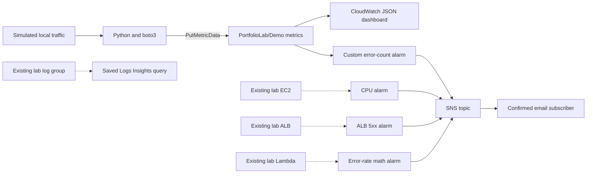

# CloudWatch Observability Portfolio Lab

Matthew Coggins | AWS monitoring and SRE portfolio demo

This is a portfolio lab, not a production deployment or a claim of work at any company. It demonstrates infrastructure as code, metric selection, alarm tuning, dashboards, log investigation, and email notification wiring. No live AWS deployment or email delivery is claimed by the checked-in scaffold.

## Architecture



Solid paths form the default runnable demo. Dotted paths need existing lab resources. This module does not create billable compute, a load balancer, Lambda functions, or log ingestion. The local app publishes real custom metrics about a simulated workload, not fake AWS service metrics.

## What each component proves

| Component | Monitoring skill |
| --- | --- |
| `main.tf`, `variables.tf`, `outputs.tf` | Reproducible, parameterized AWS observability infrastructure |
| EC2 CPU alarm | Average CPU above 80% for two five-minute periods, compatible with basic monitoring |
| ALB 5xx alarm | At least five load-balancer-generated 5xx responses per minute, not target-generated errors |
| Lambda error-rate alarm | Metric math: errors / invocations times 100, alarm at 5%, zero-invocation guard |
| Custom demo alarm | At least ten errors per minute, matched namespace and dimensions, missing data treated as healthy |
| `dashboard.json` | Latency, error totals, and alarm state in one three-widget dashboard |
| Saved Logs Insights query | Recent error investigation across an existing log group selected at query time |
| SNS topic and email subscription | Account-scoped CloudWatch publish policy and human-confirmed alert delivery |
| `sample-app/` | Bounded-cardinality custom metrics using the AWS SDK credential chain |

The native service alarms are created when their corresponding resource inputs are supplied. They are skipped by default to avoid meaningless alarms against nonexistent resources. Missing EC2 data is unknown; sparse ALB, Lambda, and demo errors are non-breaching. This is a demo policy, not a recommendation to hide telemetry failures in production.

## Five-minute quickstart

Allow roughly five minutes of hands-on setup, plus provider download, SNS confirmation, and CloudWatch evaluation time. Alarm email may take several additional minutes. Prerequisites: Terraform 1.5+, Python 3.9+, an AWS sandbox account, authenticated AWS credentials, and an inbox you control. Use the same AWS account and region in Terraform and Python. Do not put access keys or personal email addresses in Git.

Your Terraform identity needs permission to manage CloudWatch alarms, dashboards, saved queries, and SNS topics, policies, and subscriptions, plus STS identity lookup. The app identity needs only `cloudwatch:PutMetricData`, with resource `*` and a `cloudwatch:namespace` condition restricted to `PortfolioLab/Demo`. This lab does not create IAM users, keys, or permissions.

```bash
git clone git@github.com:yellowlotuscg/cloudwatch-observability-lab.git
cd cloudwatch-observability-lab
export AWS_DEFAULT_REGION=us-east-1
export TF_VAR_aws_region="$AWS_DEFAULT_REGION"
read -r -p 'Alert email: ' TF_VAR_alert_email
export TF_VAR_alert_email

terraform init
terraform plan
terraform apply
```

Review the plan before approving apply. The default plan manages one custom alarm, one dashboard, one saved query, one SNS topic, its policy, and its email subscription. Open the AWS Notifications subscription email and click Confirm subscription before generating failures.

```bash
python3 -m venv .venv
source .venv/bin/activate
python -m pip install -r sample-app/requirements.txt

# Healthy baseline, then an intentional error burst.
python sample-app/app.py --requests 10
bash sample-app/simulate-traffic.sh
terraform output demo_alarm_name
terraform output dashboard_name
```

In the selected region, open CloudWatch > Alarms and the dashboard named by the outputs. Allow several minutes for metrics and evaluation. Look for `ALARM` on the demo error alarm and check the confirmed inbox for an SNS email. The script sends forty failures quickly so a minute boundary does not normally prevent a breach. Exceptionally slow API calls can spread them out; rerun if the per-minute sum never reaches ten.

For recovery, run the healthy app again and wait for a non-breaching period. Missing demo data also recovers to `OK`. SNS sends notifications on state transitions, not on every failing request, so repeated bursts while already in `ALARM` do not generate new alarm transitions. `OK` notifications are enabled for the demo alarm.

### Enable all three native service alarms

Before plan/apply, optionally set existing sandbox resource identifiers:

```bash
export TF_VAR_ec2_instance_id=i_REPLACE_WITH_LAB_INSTANCE_ID
export TF_VAR_alb_arn_suffix=app/REPLACE_WITH_LAB_ALB_NAME/REPLACE_WITH_ID
export TF_VAR_lambda_function_name=REPLACE_WITH_LAB_FUNCTION_NAME
terraform plan
terraform apply
```

These must be real resources in the same account and region. The local traffic script trips only the custom alarm. Testing native alarms requires workload on those actual services and may incur compute charges. The EC2 alarm needs two five-minute breaching periods. The saved query appears under CloudWatch Logs Insights saved queries: select an existing sandbox log group and a short time range before running it. App stdout is local JSON and is not automatically shipped to CloudWatch Logs.

## Cost and cleanup

Designed to stay within available AWS free-tier allowances for a short, otherwise-unused eligible account: two custom metric series, one dashboard with three widgets, standard-resolution alarms, and a tiny number of SNS emails and metric API calls. Free is not guaranteed. Eligibility, credits, existing account usage, region pricing, and metric-math alarm billing can change the bill. Check [CloudWatch pricing](https://aws.amazon.com/cloudwatch/pricing/), [SNS pricing](https://aws.amazon.com/sns/pricing/), and your account's Billing console before applying. Existing EC2/ALB/Lambda costs are separate. Running Logs Insights queries can charge for bytes scanned.

```bash
terraform destroy
unset TF_VAR_alert_email
```

Review and approve destroy after the demo, keeping the same AWS account, region, and variables. Destroy removes Terraform-managed monitoring resources, not existing compute or historical metric datapoints. Custom metric history ages out under AWS retention after publishing stops. Keep local state private until teardown is verified; state contains the subscription email. Do not publish state, plans, credentials, or unredacted screenshots.

## Screenshots: placeholder images only

No AWS screenshots have been captured for this scaffold. The following are explicit placeholder image slots, not evidence of execution:

| Placeholder image | Replace with after a real sandbox run |
| --- | --- |
| `[PLACEHOLDER IMAGE: dashboard]` | Dashboard with real latency and error datapoints |
| `[PLACEHOLDER IMAGE: alarm history]` | Demo alarm transition from OK to ALARM and back |
| `[PLACEHOLDER IMAGE: email]` | Confirmed SNS alert, with inbox and account identifiers redacted |
| `[PLACEHOLDER IMAGE: Logs Insights]` | Saved query run against a real sandbox log group |

## Local validation

```bash
python -m pip install python-hcl2
python -c 'import pathlib,hcl2; [hcl2.loads(p.read_text()) for p in pathlib.Path(".").rglob("*.tf") if ".terraform" not in p.parts]; print("HCL parse passed")'
python3 -m py_compile sample-app/app.py
python -m unittest discover -s tests -v
bash -n sample-app/simulate-traffic.sh
terraform fmt -check
terraform validate
```

HCL parsing is not a provider schema check. Local unit tests use botocore Stubber and a mocked client, never AWS credentials or real API calls. They verify metric payloads and that the traffic script exercises forty failing requests. Live AWS provisioning, alarm transitions, and email delivery require a separate sandbox run.

## Troubleshooting

- No metrics: check credentials, `cloudwatch:PutMetricData`, account, region, namespace, and `App=demo` dimension. SDK failures exit nonzero rather than claiming success.
- No email: confirm the subscription first, check spam, verify an actual alarm state transition, and inspect the SNS topic policy.
- Empty native alarms: supply real resource identifiers and generate traffic on those services.
- Empty Logs Insights results: select a log group with matching error messages and widen the time window cautiously.
- Reruns: let the alarm return to OK before triggering another burst. Avoid running multiple lab copies with the same resource names in one account and region.

## License

MIT. Copyright (c) 2026 Matthew Jon Reid Coggins.
