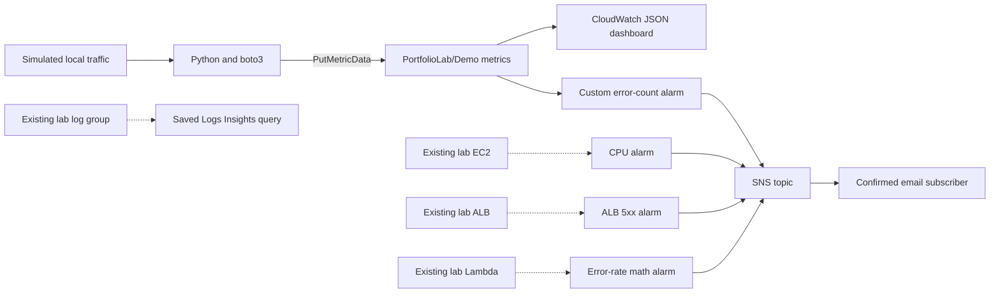

# CloudWatch Observability Portfolio Lab

Matthew Coggins

This is a portfolio lab for AWS monitoring. It is not a production system, and it is not work from a job. Terraform builds the CloudWatch alarms, a dashboard, a saved Logs Insights query, and an SNS topic that emails you. A small Python app, running on your machine, publishes custom metrics for traffic it simulates.

The default configuration does not create EC2 instances, a load balancer, Lambda functions, or a log pipeline. Alarms for those services are optional. They attach only when you point them at resources that already exist in a sandbox account.

Nothing in this repo is a record of a live AWS deployment or of an email that was delivered. The image slots near the bottom are placeholders.

## Architecture



Solid arrows are the path you can run as-is. Dotted arrows need lab resources you already have. The app publishes real custom metrics in the `PortfolioLab/Demo` namespace. Those metrics describe the simulated workload. They are not stand-ins for EC2, ALB, or Lambda metrics.

## What each part is for

| Piece | What it shows |
| --- | --- |
| `main.tf`, `variables.tf`, `outputs.tf` | The same monitoring setup, built from parameters, every time |
| EC2 CPU alarm | Average CPU above 80% for two periods of five minutes, which lines up with basic EC2 monitoring |
| ALB 5xx alarm | At least five 5xx responses generated by the load balancer in one minute. Errors generated by the targets are a different metric |
| Lambda error-rate alarm | Metric math: errors divided by invocations, times 100. It alarms at 5%, and stays at zero when nothing was invoked |
| Custom demo alarm | At least ten errors in one minute, on the demo namespace and the `App=demo` dimension. Missing data is treated as healthy |
| `dashboard.json` | Latency, error totals, and alarm state on one dashboard with three widgets |
| Saved Logs Insights query | A short look at recent errors. You choose an existing log group when you run it |
| SNS topic and email subscription | CloudWatch in this account is allowed to publish, and a person has to confirm the email before anything is delivered |
| `sample-app/` | Custom metrics with a small, fixed set of dimensions, using the normal AWS credential chain |

The EC2, ALB, and Lambda alarms are created only when you pass the matching resource id. They are off by default, so you do not get alarms for resources that are not there. Missing EC2 data stays unknown. Sparse ALB, Lambda, and demo errors count as not breaching. That is a choice for this demo. Treating missing telemetry as healthy is a poor fit for production.

## Check it on your machine

You can run this section with no AWS account and no credentials. GitHub Actions runs the same unit tests and Terraform checks on pull requests and on pushes to `main`. The workflow does not call AWS.

You need Python 3.9 or newer and Terraform 1.5 or newer, below 2.0. From the repo root:

```bash
git clone https://github.com/yellowlotuscg/cloudwatch-observability-lab.git
cd cloudwatch-observability-lab
python3 -m venv .venv
source .venv/bin/activate
python -m pip install -r sample-app/requirements.txt
```

`sample-app/requirements.txt` installs `boto3`. The unit tests import it. If you skip that install, `python -m unittest` fails before it runs anything.

```bash
python3 -m py_compile sample-app/app.py
python -m unittest discover -s tests -v
bash -n sample-app/simulate-traffic.sh
terraform fmt -check
terraform init -backend=false
terraform validate
```

The tests stub the AWS SDK. They check the metric payload and that the traffic script asks for forty failing requests. They do not use credentials and they do not call AWS. `terraform init -backend=false` downloads the AWS provider plugin so `validate` can check the configuration against that plugin. It does not set up a backend, and it does not need AWS credentials. `validate` does not create or change resources.

Parsing the `.tf` files with `python-hcl2` is optional, and it does not check the provider schema:

```bash
python -m pip install python-hcl2
python -c 'import pathlib,hcl2; [hcl2.loads(p.read_text()) for p in pathlib.Path(".").rglob("*.tf") if ".terraform" not in p.parts]; print("HCL parse passed")'
```

A real alarm change and a real email still need the sandbox steps below.

## Run it in a sandbox

Plan on about five minutes of hands-on setup, plus the provider download, the SNS confirmation, and CloudWatch evaluation. The alarm email can take several more minutes. You need an AWS sandbox account, credentials for that account, and an inbox you control. Use the same account and region in Terraform and in Python. Do not commit access keys or your email address.

The identity you give Terraform needs permission to manage CloudWatch alarms, dashboards, and saved queries, plus SNS topics, their policies, and subscriptions. It also needs to read the caller identity from STS. The app identity only needs `cloudwatch:PutMetricData` on resource `*`, limited by a `cloudwatch:namespace` condition to `PortfolioLab/Demo`. This lab does not create IAM users, access keys, or permissions.

The sample app uses the same virtualenv as the tests. Skip these three lines if that environment is already active:

```bash
python3 -m venv .venv
source .venv/bin/activate
python -m pip install -r sample-app/requirements.txt

export AWS_DEFAULT_REGION=us-east-1
export TF_VAR_aws_region="$AWS_DEFAULT_REGION"
read -r -p 'Alert email: ' TF_VAR_alert_email
export TF_VAR_alert_email

terraform init
terraform plan
terraform apply
```

Read the plan before you approve apply. With the defaults, Terraform manages one custom alarm, one dashboard, one saved query, one SNS topic, the topic policy, and the email subscription. Open the AWS subscription email and confirm it before you generate failures.

```bash
# A healthy baseline, then a burst of errors.
python sample-app/app.py --requests 10
bash sample-app/simulate-traffic.sh
terraform output demo_alarm_name
terraform output dashboard_name
```

In the region you chose, open CloudWatch, then Alarms, and open the dashboard named in the outputs. Give metrics and evaluation a few minutes. You are looking for `ALARM` on the demo error alarm, and for an SNS email in the inbox you confirmed. The script sends forty failures quickly so they usually land in the same minute. If the API is unusually slow, the count can split across two minutes. Run the script again if the per-minute sum never reaches ten.

To clear the alarm, run the healthy app again and wait for a period that does not breach. If the demo metrics stop arriving, missing data also returns the alarm to `OK`. SNS emails you when the state changes, not for every failed request. Another burst while the alarm is already `ALARM` does not send a new transition email. The demo alarm does notify you when it returns to `OK`.

### Turn on the three service alarms

This part is optional. Set the ids before plan and apply. They have to be real resources in the same sandbox account and region:

```bash
export TF_VAR_ec2_instance_id=i_REPLACE_WITH_LAB_INSTANCE_ID
export TF_VAR_alb_arn_suffix=app/REPLACE_WITH_LAB_ALB_NAME/REPLACE_WITH_ID
export TF_VAR_lambda_function_name=REPLACE_WITH_LAB_FUNCTION_NAME
terraform plan
terraform apply
```

The local traffic script only trips the custom alarm. Testing the EC2, ALB, or Lambda alarms means putting load on those services, and that can cost money. The EC2 alarm needs two breaching periods of five minutes. The saved query is listed under CloudWatch Logs Insights saved queries. Pick an existing log group and a short time range before you run it. The app prints JSON to your terminal. It does not send those lines to CloudWatch Logs.

## Cost and cleanup

The lab is sized to stay inside the CloudWatch and SNS free tier for a short run on an eligible account that is not already using those services: two custom metric series, one dashboard with three widgets, standard-resolution alarms, and a small number of SNS emails and metric API calls. Free is not guaranteed. Eligibility, credits, other usage in the account, region prices, and metric-math alarm billing can all change what you are charged. Check [CloudWatch pricing](https://aws.amazon.com/cloudwatch/pricing/), [SNS pricing](https://aws.amazon.com/sns/pricing/), and the Billing console before you apply. Existing EC2, ALB, and Lambda costs are separate. A Logs Insights query can charge for the bytes it scans.

```bash
terraform destroy
unset TF_VAR_alert_email
```

Use the same account, region, and variables, and read the destroy plan before you approve it. Destroy removes the monitoring resources Terraform created. It does not remove existing compute, and it does not delete old metric data points. Custom metric history ages out under AWS retention after you stop publishing. Keep the local state file private until you have confirmed that teardown finished. State contains the subscription email. Do not publish state, plans, credentials, or screenshots that still show an account or an inbox.

## Screenshots: placeholders only

There are no AWS screenshots in this repo. These rows are labels for images you would add after a real sandbox run:

| Placeholder | Replace with, after a real sandbox run |
| --- | --- |
| `[PLACEHOLDER IMAGE: dashboard]` | The dashboard, showing real latency and error points |
| `[PLACEHOLDER IMAGE: alarm history]` | The demo alarm moving from OK to ALARM and back |
| `[PLACEHOLDER IMAGE: email]` | The confirmed SNS email, with the inbox and account identifiers removed |
| `[PLACEHOLDER IMAGE: Logs Insights]` | The saved query, run against a real sandbox log group |

## Troubleshooting

- No metrics: check the credentials, `cloudwatch:PutMetricData`, the account, the region, the namespace, and the `App=demo` dimension. If the SDK call fails, the app exits with an error. It does not print success.
- No email: confirm the subscription, check spam, and make sure the alarm actually changed state. Then look at the SNS topic policy.
- The service alarms never show up: pass real resource ids, then generate traffic on those services.
- Logs Insights comes back empty: choose a log group that contains matching error text, and widen the time range a little if you need to.
- Running the burst again: wait until the alarm is OK first. Avoid two copies of this lab with the same resource names in one account and region.

## License

MIT. See [LICENSE](LICENSE). Copyright (c) 2026 Matthew Coggins.
